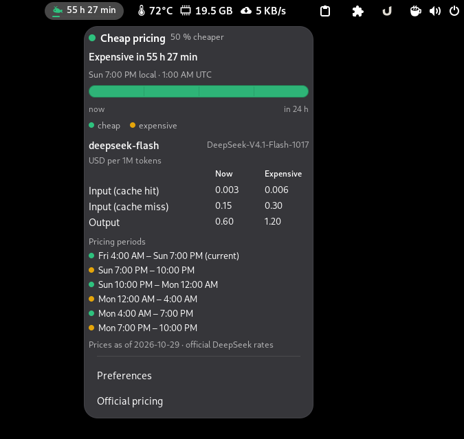
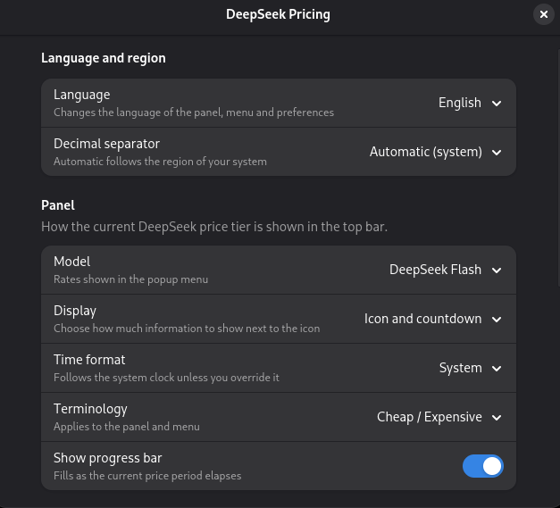
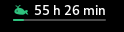

# DeepSeek Pricing

[Español](README.es.md) | **English**

[](https://github.com/Alarez777/gnome-extension-deepseek-pricing/actions/workflows/ci.yml)
[](LICENSE)

GNOME Shell extension that shows whether the DeepSeek API is currently on the **cheap** or **expensive** rate, with a countdown to the next change, a 24-hour timeline and the official prices per million tokens.

- Custom whale in the panel: green when cheap, amber when expensive.
- Thin underline that fills as the current block progresses; when the status or countdown is shown, it stretches under the text.
- Click to see status, countdown, 24-hour timeline, current/alternate prices and upcoming blocks with their range (the current one is highlighted).
- Hovering over the timeline shows a position line and a tooltip with the time block and its state (`Expensive · 22:00–00:00`).
- Native preferences (Adw) for language, decimal separator, model, panel mode, time format, terminology and progress bar.
- Spanish or English UI. By default it follows the system language and falls back to English if unsupported; changes apply instantly, without restarting GNOME Shell.
- Configurable decimal separator: by default it follows the system region (Mexico → `0.003`, Spain → `0,003`) and can be forced to a dot or a comma.
- 12- or 24-hour clock: follows the GNOME clock by default, with an option to force either.
- Configurable terminology: **Cheap/Expensive** (simple, default) or **Off-peak/Peak** (official).
- No automatic network requests, no telemetry and no API keys: everything is computed locally. The only external link is the official pricing page, which opens the browser when clicked.
- Publishable on [extensions.gnome.org](https://extensions.gnome.org) (GJS/JS only).


## Screenshots

| Popup | Preferences |
|---|---|
|  |  |

| Panel mode | Cheap | Expensive |
|---|---|---|
| **Icon only** — the whale color shows the current rate. |  |  |
| **Icon and status** — adds *Cheap* or *Expensive* next to the icon. |  |  |
| **Icon and countdown** — adds the time left until the next change. |  |  |

## Schedule and prices

DeepSeek changed its pricing scheme in August 2026:

- **Peak:** 01:00–04:00 and 06:00–10:00 **UTC**, Monday to Friday, excluding Chinese public holidays.
- **Off-peak:** everything else, including weekends and full holidays.
- Off-peak costs **50%** of peak.

The UI uses **cheap** and **expensive** by default so it is easy to read at a glance; Preferences → *Terminology* switches to **off-peak** and **peak**, the names used in the official documentation.

| USD / 1M tokens | Flash off-peak | Flash peak | Pro off-peak | Pro peak |
|---|---|---|---|---|
| Input (cache hit) | 0.003 | 0.006 | 0.022 | 0.044 |
| Input (cache miss) | 0.15 | 0.30 | 0.66 | 1.32 |
| Output | 0.60 | 1.20 | 1.98 | 3.96 |

Source: [Models & Pricing](https://api-docs.deepseek.com/quick_start/pricing). Verified on 2026-10-29.

The working day is decided in **UTC**, not in your local time. For example, in `America/Mexico_City` (UTC−6) the expensive block falls on:

- Sunday to Thursday, 19:00–22:00 local time;
- Monday to Friday, 00:00–04:00 local time.

That is why Sunday evening can be expensive (it is already Monday in UTC) and Friday evening is cheap (it is already Saturday in UTC). The popup timeline makes that clear visually.

In Mexico the long cheap block runs from **Friday 04:00 to Sunday 19:00**; then there is a peak on Sunday 19:00–22:00, a cheap gap from 22:00 to 00:00, and another peak on Monday 00:00–04:00. The timeline tooltip shows the real end of the block even if it falls outside the next 24 hours.

## Language and numbers

The interface is available in Spanish and English. In Preferences → *Language and region*:

- **Language:** *Automatic* follows the system language; if it is neither Spanish nor English, English is used. You can also force *English* or *Español*. Changes apply to the panel, popup and preferences instantly.
- **Decimal separator:** *Automatic* follows the system region (Mexico → `0.003`, Spain → `0,003`); if the system is neither Spanish nor English, a dot is used. You can also force a dot or a comma. Spanish has no single rule: the RAE documents a comma in Spain, Argentina, Chile, Colombia, Ecuador, Paraguay, Peru and Uruguay, a dot in Mexico, Central America, the Caribbean and Venezuela, and recommends the dot for consistency.

## Requirements

- GNOME Shell 48 (tested on 48.7).
- To build: Node.js 20+, npm, `glib-compile-schemas` and `zip`.
- To test: `gjs` and, optionally, a nested shell (`gnome-shell --nested --wayland`).

## Install

```sh
git clone https://github.com/Alarez777/gnome-extension-deepseek-pricing.git
cd gnome-extension-deepseek-pricing
npm install
make pack          # creates deepseek-pricing.zip
make install       # copies to ~/.local/share/gnome-shell/extensions/
```

Then:

```sh
gnome-extensions enable deepseek-pricing@alarez777.github.io
```

On Wayland you must log out and back in **every time you install or update**: GNOME Shell does not reload extension code while running. On X11 you can restart the shell with `Alt+F2` → `r`.

To check that the installed copy matches `dist/`:

```sh
make verify-install
```

To uninstall:

```sh
make uninstall
```

## Development

```sh
npm run typecheck  # strict tsc over src + tests
npm test           # node:test over the pure pricing logic
make build         # compiles TS + copies assets + compiles the schema

# Nested shell to test without affecting your session:
make install
dbus-run-session -- gnome-shell --nested --wayland
# in a terminal inside that session:
gnome-extensions enable deepseek-pricing@alarez777.github.io
```

Logs:

```sh
journalctl -f -o cat /usr/bin/gnome-shell
```

The pricing, holiday and segment logic lives in `src/pricing/` and **does not import GJS**, so tests run on Node. The UI (`indicator.ts`, `menu.ts`, `timeline.ts`) is GJS/St and is tested manually.

## Data and maintenance

- **Prices:** `src/pricing/prices.ts` (integers in micro-USD per 1M tokens) and `PRICES_AS_OF`. Update them when DeepSeek changes its rates; publish a new version.
- **Chinese holidays:** `src/pricing/holidays.ts`, generated from [holiday-cn](https://github.com/NateScarlet/holiday-cn) and State Council notices (`gov.cn`). Only non-working days are listed; weekends are already cheap.
- **2027:** the calendar is published around November 2026. While it is missing, the popup warns and only the weekend rules apply. Add the year and update `HOLIDAY_DATA_UPDATED`.
- The popup shows the price date so its age is visible.

## Structure

```
src/
  extension.ts        # Extension: enable/disable
  indicator.ts        # panel, icon, progress, timers, settings
  menu.ts             # popup: status, timeline, prices, links
  timeline.ts         # Cairo drawing of the next 24 h
  prefs.ts            # Adw window
  colors.ts           # palette shared with CSS and the SVGs
  i18n/
    messages.ts       # English/Spanish catalogs (typed)
    locale.ts         # language and decimal separator detection (pure)
    index.ts          # translator for the Shell and preferences
  pricing/
    schedule.ts       # tier, next change, segments (pure)
    holidays.ts       # Chinese calendar (pure)
    prices.ts         # official rates (pure)
    clock.ts          # 12 h / 24 h and time formatting (pure)
    terms.ts          # cheap/expensive or off-peak/peak terminology (pure)
    format.ts         # local/UTC times and durations (GLib)
tests/                # tests for the pure logic
icons/                # original whale, green and amber
schemas/              # GSettings
```

## Project rules

- The panel shows the state with the icon and color; the panel text is optional ("Icon and status" or "Icon and countdown" preference).
- The UI does not reimplement the pricing rules: `getStatus()` returns the 24-hour segments and the next change; the popup only paints them.
- `disable()` removes timers, signals and actors. No GObject is created when importing modules.
- The project does not use the network. Future API balance/usage would require a new phase and secure key storage.

## Known limitations

- Only GNOME Shell 48 is advertised (tested on 48.7). GNOME 49–51 are untested: 51 removes the `St.BoxLayout.vertical` property, which this code still uses. To port it, replace it with `orientation: Clutter.Orientation.VERTICAL` (compatible with 48), update `shell-version` in `metadata.json` and test on each version before advertising it.
- GNOME 49 removed nested mode `--nested` (use `--devkit --wayland`) and GNOME 50 removed X11, so the `Alt+F2` → `r` restart instructions only apply to 48.
- GNOME 48 does not expose tooltips on `St`; the information is in the popup and in the optional text mode.
- It shows official per-token rates, not your spending or actual balance.
- The name and description GNOME shows in the extension list come from `metadata.json` and do not change with the language preference.
- Prices are in USD; there is no currency conversion.
- The progress bar advances within the current block; on a long weekend it moves slowly by design.

## Publishing to extensions.gnome.org

```sh
make pack
```

Upload `deepseek-pricing.zip`. The ZIP contains only the compiled JS, `metadata.json`, `stylesheet.css`, icons and the compiled schema: it does not include `src/`, tests, `node_modules` or build scripts.

Before submitting:

- Make sure the UUID (`deepseek-pricing@alarez777.github.io`) matches your GitHub account/namespace. If you change the namespace, update `metadata.json` and the `UUID` in the `Makefile`.
- The icon is an original whale, not the DeepSeek logo. The name is descriptive and the description includes the non-affiliation disclaimer.
- EGO guidelines require the author to be able to explain the code; review and adapt whatever is needed before publishing.
- Check the review list: nothing is created outside `enable()`, everything is destroyed in `disable()`, no GTK in the Shell process, no binaries, no telemetry.

## License

GPL-2.0-or-later. See [LICENSE](LICENSE).

This project is not affiliated with or endorsed by DeepSeek. "DeepSeek" is used only to describe compatibility.
